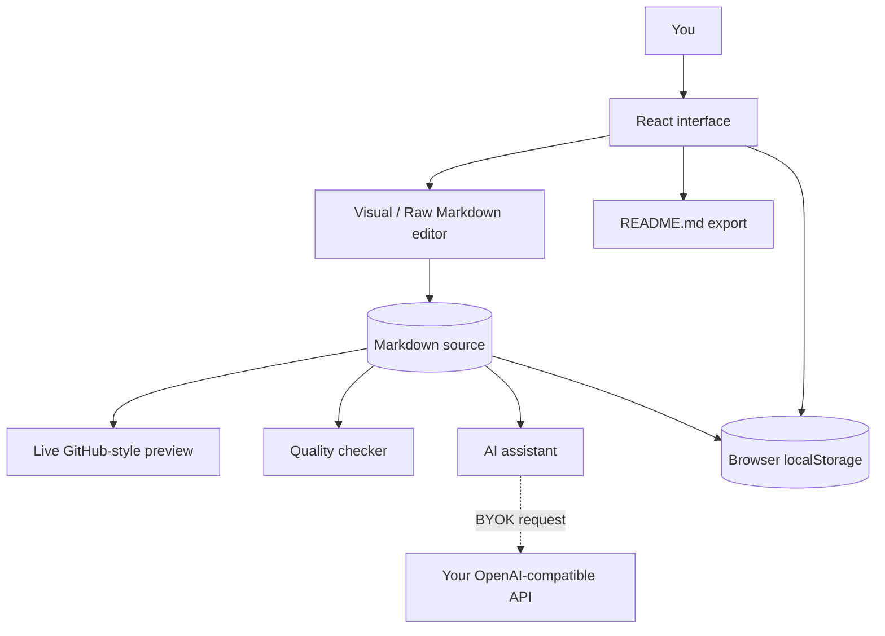

<div align="center">

<picture>
  <source media="(prefers-color-scheme: dark)" srcset="assets/readme-studio-wordmark-dark.png">
  
</picture>

<h3>A better way to build your README.</h3>

<p>
  README Studio is a calm, local-first Markdown workspace for drafting, previewing and polishing project documentation.<br>
  Write visually or in raw Markdown, see a GitHub-style preview instantly, and ship a README you are proud of.
</p>

<p>
  
  
  
  
  
  
  
</p>

<p>
  <a href="#demo">Demo</a> ·
  <a href="#features">Features</a> ·
  <a href="#quick-start">Quick start</a> ·
  <a href="#the-ai-assistant">AI assistant</a> ·
  <a href="#quality-score">Quality score</a> ·
  <a href="#documentation">Documentation</a> ·
  <a href="#become-a-contributor">Become a contributor</a> ·
  <a href="#tech-stack">Tech stack</a>
</p>

</div>

---

## Why README Studio

Most README files are written in a text area, then checked by switching tabs. README Studio keeps the whole job in one focused place.

| Write with focus | See every change | Publish with confidence |
| :---: | :---: | :---: |
| A real Markdown editor with a visual block mode and a raw source mode. | A live, GitHub-style preview updates as you type. | A quality score catches the details that make documentation useful. |

The app is designed around a few simple beliefs: writing documentation should feel calm, work should stay on your machine, and a README should be reviewable before it is published.

## Demo

The fastest way to understand README Studio is to use it for a minute.

**Live demo:** [yxoro.github.io/readme-studio](https://yxoro.github.io/readme-studio/) — the production build, hosted on GitHub Pages. No install and no account.

| In your browser | On your machine | From a real document |
| :---: | :---: | :---: |
| [Open in StackBlitz](https://stackblitz.com/github/Yxoro/readme-studio) | `npm install`, then `npm run dev` | [Import the sample README](demo/sample-readme.md) |
| A fresh clone boots in a tab, with dependencies installed on first load. | Vite prints a local URL, usually `http://localhost:5173`. | A finished document for the guided tour. |

### The 60-second tour

1. Start the app and open the local URL.
2. Select **Import** in the top bar and choose [`demo/sample-readme.md`](demo/sample-readme.md).
3. Click the description in the Visual Editor and rewrite one sentence. The GitHub-style preview updates as you type.
4. Open the **Quality** tab in the preview panel. The sample scores 100; remove its `## License` heading and watch the score and recommendations react.
5. Switch to **Raw Markdown**, press `Ctrl / ⌘ + S`, then **Export README.md** to download the file.

The full walkthrough lives in [`demo/README.md`](demo/README.md). Everything you do in the demo stays in your browser — there is no account and no backend to clean up afterwards.

## Features

### A genuine Markdown editor

- **Visual Editor** renders the document as formatted blocks. Click any block to edit its Markdown inline.
- **Raw Markdown** exposes the complete source in a monospace editor.
- Formatting toolbar for headings, bold, italic, inline code, fenced code, lists, numbered lists, quotes, links, images, tables and horizontal rules.
- Undo and redo history, with keyboard shortcuts.
- Word count, character count and estimated reading time.

### Live documentation preview

- GitHub-flavored Markdown rendering with `remark-gfm`.
- Tables, task lists, images, badges, blockquotes and links.
- Syntax highlighting for fenced code blocks.
- A Preview panel that stays in sync with the current document.

### Templates and reusable components

Start with a complete structure instead of a blank page.

| Template | Best for |
| --- | --- |
| Open Source Project | Public repositories and community work |
| React Application | Front-end applications built with React |
| Python Project | Packages, libraries and command-line tools |
| Godot Game | Game projects and playable builds |
| API Documentation | REST services and developer APIs |
| Portfolio | Personal profiles and selected work |
| CLI Tool | Command-line utilities and developer tools |

The **component library** inserts ready-to-edit sections at your cursor: project description, features, installation, usage, screenshots, tech stack, roadmap, contributing, license, acknowledgements, GitHub badges and live demo.

### Local-first document management

- Create, open, rename, duplicate and delete README documents.
- Autosave with a visible **Saved / Saving** indicator.
- Documents survive a page refresh through local storage.
- Import an existing `.md` file and export the current document as a real `README.md`.
- Copy Markdown, clear a document, and inspect import or export errors through discreet notifications.

Nothing is uploaded to a README Studio backend because there is no backend.

### Everything around the writing

- Searchable project library with a clean empty state.
- Settings for editor text size, default editing mode and preview preference.
- Documentation built into the app.
- Responsive layout for desktop, tablet and mobile.
- Calm Apple-inspired visual system: light surfaces, fine borders, generous spacing and restrained motion.

### GitHub, built in

- **Live repository stats** on the home page: GitHub stars, forks, open issues and contributors, with direct links to the contributing guide, good first issues and a new issue.
- **Table of contents** generated from the document's headings, with GitHub-compatible anchors. Run it again to refresh the existing table.
- **Import from GitHub** fetches the README of any public repository by `owner/repo` or URL and turns it into a new local document.
- **GitHub page preview** in the preview panel places the README inside a repository page layout. Link a public repository to load its real description, topics, license and counters; imported READMEs link it automatically.

## Quick start

**Requirements:** Node.js 18 or newer and npm.

```bash
npm install
npm run dev
```

Open the local URL printed by Vite, usually `http://localhost:5173`.

Build the production bundle with:

```bash
npm run build
npm run preview
```

No environment variables are required. AI provider settings are configured in the app and are never committed to the repository.

Continue with the [getting started guide](docs/GETTING-STARTED.md), or run the [60-second demo](#demo) first.

## The AI assistant

README Studio includes an optional AI editing panel that works with **your own API key**.

1. Open a README and select **AI** in the top bar.
2. Choose **Add API key**.
3. Enter an OpenAI-compatible API base URL, a model name and your key.
4. Use **Test connection**, then **Save settings**.

The default configuration points to Z.ai:

| Setting | Default |
| --- | --- |
| API base URL | `https://api.z.ai/api/paas/v4` |
| Model | `glm-4-flash` |
| API style | OpenAI-compatible chat completions |

Any compatible provider can be configured. The browser appends `/chat/completions` when the base URL does not already include it.

### Live edits, not a chat transcript

Describe what you want in plain language. The assistant returns a complete updated README and the editor applies it live as the response streams in.

- Stop a long generation at any time.
- Review the document as it changes.
- Undo changes with `Ctrl / ⌘ + Z`.
- Use quick prompts for clearer copy, better installation steps, a features table or tighter grammar.

### Promo README

The **Promo README** tab turns a raw idea into a promotional concept README.

- No existing project description required.
- Generates a complete Markdown document from a single idea.
- Clearly frames the result as a concept rather than a shipped product.
- Avoids invented metrics, testimonials, customers and launch claims.
- Creates a new document when generation finishes, leaving existing work untouched.

> **API key safety:** The key is stored in your browser's local storage and sent directly to the endpoint you configure. Use a dedicated key with a spending limit, and do not use a key with broader permissions than necessary. Some providers block browser requests (CORS); the **Test connection** button will surface that problem.

## Quality score

The Quality panel analyzes the current README and produces a score out of 100 with actionable recommendations.

| Check | What it looks for |
| --- | --- |
| Project title | A clear H1 title |
| Description | A short explanation below the title |
| Installation | Installation or getting-started guidance |
| Usage examples | A usage section with practical context |
| License | License information for contributors and users |
| Image alt text | Images that are missing alternative text |
| Link formatting | Empty URLs, spaces in destinations and unsafe schemes |
| Section content | Headings with no content underneath |

The five core sections are worth 100 points combined. Accessibility, link and empty-section issues deduct points, and the score updates live as the document changes. Recommendations explain exactly what to improve.

## Documentation

Four guides cover the project at different depths.

| Guide | What it covers |
| --- | --- |
| [Getting started](docs/GETTING-STARTED.md) | Requirements, first document, templates, AI setup, build and troubleshooting |
| [Architecture](docs/ARCHITECTURE.md) | State flow, storage keys, AI transport, quality scoring and extension points |
| [Demo](demo/README.md) | The sample document and a one-minute guided tour |
| [Contributing](CONTRIBUTING.md) | Setup, conventions, review checklist and first-issue guidance |

The same guidance is available inside the app from **Documentation** in the sidebar, so it works without a network connection.

## Keyboard shortcuts

| Shortcut | Action |
| --- | --- |
| `Ctrl / ⌘ + S` | Save immediately |
| `Ctrl / ⌘ + Z` | Undo |
| `Ctrl / ⌘ + Shift + Z` | Redo |
| `Ctrl / ⌘ + Y` | Redo |
| `Esc` | Close dialogs and finish editing a block |
| `Ctrl / ⌘ + Enter` | Finish editing a block |

## Design principles

> Calm software is useful software.

- **Local by default.** Documents, preferences and AI credentials stay in the browser.
- **Visible state.** Saving, provider status and quality are never hidden behind a spinner with no explanation.
- **No decorative controls.** Every button has a job.
- **Readable first.** Generous spacing, restrained color and typography that stays out of the way.
- **Keyboard friendly.** Writing, saving and undoing do not require the mouse.

## Architecture



Everything runs in the browser:

- The React UI holds the editor session.
- The Markdown source is the single source of truth for the editor, preview, quality score and AI edits.
- Documents and preferences are persisted in local storage.
- AI requests go directly from the browser to the endpoint configured by the user.

## Tech stack

| Concern | Technology |
| --- | --- |
| Framework | React 18 |
| Language | TypeScript, strict mode |
| Build tool | Vite 5 |
| Styling | Tailwind CSS 3 |
| Markdown rendering | react-markdown, remark-gfm, rehype-highlight |
| Icons | Lucide React |
| Persistence | Browser local storage |
| AI transport | `fetch` to an OpenAI-compatible endpoint |

## Project structure

```text
.
├── assets/                  README wordmark assets
├── logo/                    Original brand logo
├── public/                  Static files and favicon
├── src/
│   ├── components/          Editor, preview, AI, documents and dialogs
│   ├── hooks/               Document store and autosave
│   ├── lib/                 Markdown, AI, files, quality and storage helpers
│   ├── templates/           README templates
│   ├── types/               Shared TypeScript types
│   ├── App.tsx              Application shell
│   ├── index.css            Design system and Markdown styles
│   └── main.tsx             React entry point
├── demo/                    Sample README and guided tour
├── docs/                    Getting started and architecture guides
├── CONTRIBUTING.md          Contributor guide
├── index.html
├── package.json
├── tailwind.config.js
└── vite.config.ts
```

## Available scripts

| Command | Description |
| --- | --- |
| `npm run dev` | Start the local Vite development server |
| `npm run build` | Type-check the project and create a production build |
| `npm run preview` | Preview the production build locally |

## Data and privacy

- No account is required.
- No application backend receives your documents.
- Documents and settings are stored in local storage for the current browser profile.
- The AI provider only receives the README content and instruction you send while using the assistant.
- **Settings → Delete all data** removes documents, preferences and AI credentials from the browser. Export important READMEs first.

## Become a contributor

README Studio is co-authored in the open, and every contribution counts: a typo, a clearer sentence, an accessibility fix, a new template, or a bug report with exact steps. You do not need to be a maintainer to shape this project.

<p>
  <a href="https://github.com/Yxoro/readme-studio/issues/new"></a>
  <a href="https://github.com/Yxoro/readme-studio/labels/good%20first%20issue"></a>
  <a href="CONTRIBUTING.md"></a>
</p>

Pick the entry point that matches the time you have:

| Contribution | Start here |
| --- | --- |
| Report a bug | [Open an issue](https://github.com/Yxoro/readme-studio/issues/new) with the steps, your browser and what you expected |
| Ask for a feature | Describe the outcome you want and the workflow it unblocks |
| Improve the documentation | Fix a guide in `docs/`, the in-app copy, or this README |
| Add a template or component | Extend `src/templates/index.ts` or `src/lib/componentsLibrary.ts` |
| Improve accessibility or design | Keep the existing visual language, then show what changed and why |

### Your first pull request

1. Comment on an issue, or open one, so the direction is agreed before you write code.
2. Fork the repository and create a focused branch.
3. Follow the local setup and conventions in [`CONTRIBUTING.md`](CONTRIBUTING.md).
4. Run `npm run build` — it type-checks the project and produces the production bundle.
5. Open a pull request that describes the user-facing outcome, with screenshots for interface changes.

A maintainer reviews every pull request. Merged work is credited automatically in the [contributors graph](https://github.com/Yxoro/readme-studio/graphs/contributors), and a good first issue is a normal way to start.

### What makes a contribution easy to merge

- It does one thing and says so in the title.
- It respects the local-first promise: no backend, no tracking, no surprise network calls.
- It uses the design tokens in `tailwind.config.js` instead of introducing new colors.
- It keeps TypeScript strict and adds no runtime dependency unless the benefit is clear.
- It verifies `npm run build` before review.

Not sure where to start? Open an issue and describe what you want to do — a short conversation is cheaper than a large pull request that has to be redirected.

---

<div align="center">
  <picture>
    <source media="(prefers-color-scheme: dark)" srcset="assets/readme-studio-wordmark-dark.png">
    
  </picture>
  <br>
  <sub>A better way to build your README.</sub>
</div>
