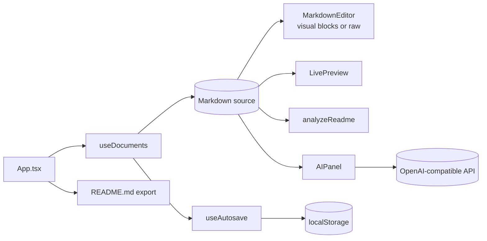

# Architecture

README Studio is a single-page React application. It has no server, no routing layer and no remote persistence: the Markdown source lives in memory, is autosaved to `localStorage`, and leaves the browser only when you explicitly call an AI provider.

## Stack

| Concern | Choice |
| --- | --- |
| Framework | React 18 |
| Language | TypeScript, strict mode, `noUnusedLocals` and `noUnusedParameters` |
| Build tool | Vite 5 |
| Styling | Tailwind CSS 3 with design tokens |
| Markdown rendering | `react-markdown` + `remark-gfm` + `rehype-highlight` |
| Icons | `lucide-react` |
| State | Local component state, two custom hooks |
| Persistence | Browser `localStorage` |
| Tests | None yet; pure logic is kept in `src/lib` |

## Runtime flow

The Markdown string is the single source of truth. The visual editor, raw editor, preview, quality report and AI edits all read from and write to that one string, which is why the panels never disagree.

## Source map

| Path | Responsibility |
| --- | --- |
| `src/App.tsx` | Application shell, view switch, panels, keyboard shortcuts, import/export, toasts |
| `src/hooks/useDocuments.ts` | Document collection, active document, undo/redo history |
| `src/hooks/useAutosave.ts` | Debounced persistence and save status |
| `src/components/MarkdownEditor.tsx` | Visual block editor and raw textarea |
| `src/components/MarkdownToolbar.tsx` | Formatting actions applied to the current selection |
| `src/lib/markdown.ts` | Counters, formatting transforms, block parser |
| `src/components/PreviewPanel.tsx` | Preview and Quality tabs |
| `src/components/MarkdownBody.tsx` | Shared GitHub-flavored renderer |
| `src/lib/qualityChecker.ts` | Score, checks and recommendations |
| `src/lib/ai.ts` | Provider config, endpoint building, streaming, prompts |
| `src/lib/storage.ts` | Versioned `localStorage` reads and writes |
| `src/lib/files.ts` | Import validation, download and clipboard fallback |
| `src/lib/format.ts` | ID generation and date formatting |
| `src/templates/index.ts` | Seven starter documents |
| `src/lib/componentsLibrary.ts` | Insertable Markdown sections |
| `src/index.css` | Design system and Markdown styles |

## Document state

`useDocuments` keeps an array of `ReadmeDocument` values and one active ID.

- `createDocument` prepends a document, makes its name unique with a numeric suffix, and activates it.
- `updateContent` records undo snapshots in 700 ms groups, keeps the last 80 snapshots, and clears the redo stack.
- Undo and redo are per document and live only in memory; a page reload starts fresh history.
- `deleteDocument` selects the first remaining document.
- `duplicateDocument` copies content, timestamps and name with a “copy” suffix, under a new ID.

`useAutosave` watches a `{ documents, activeId }` snapshot, waits 550 ms, then writes. It reports `saved`, `saving` or `error`, and exposes `saveNow()` for `Ctrl / ⌘ + S`. `App.tsx` also saves on `beforeunload` so a refresh does not lose the last keystrokes.

## Storage contract

| Key | Contents |
| --- | --- |
| `readme-studio.documents.v1` | JSON array of documents |
| `readme-studio.active-document.v1` | ID of the active document, removed when none is open |
| `readme-studio.settings.v1` | Editor font size, default mode, preview preference |
| `readme-studio.ai-config.v1` | Base URL, model and API key |

Reads are defensive: invalid JSON, wrong shapes and missing fields fall back to defaults or an empty workspace, so a corrupted value cannot crash the app. The `.v1` suffix is part of the schema version — bump it and migrate when a stored shape changes.

## Markdown pipeline

`parseMarkdownBlocks` in `src/lib/markdown.ts` groups lines into headings, code fences, tables, lists, quotes, dividers and paragraphs, keeping the raw slice and its character offsets. The visual editor renders each block, and edits replace that exact slice of the source.

Toolbar actions return a `FormatResult` with the next text and the selection to restore:

| Action | Behavior |
| --- | --- |
| `wrap` | Wraps the selection, or inserts a placeholder |
| `linePrefix` | Prefixes each selected line, optionally numbering or toggling headings |
| `insert` | Inserts a block and normalizes surrounding blank lines |
| `link`, `image` | Builds the syntax and selects the URL for immediate typing |

`MarkdownBody` renders with `remark-gfm` for tables, task lists and autolinks, and `rehype-highlight` for fenced code. External links open in a new tab with `rel="noopener noreferrer"`, images are lazy-loaded, and tables scroll inside a wrapper.

Word count strips code fences, image syntax and inline markup, and reading time assumes 200 words per minute.

## Quality scoring

`analyzeReadme` in `src/lib/qualityChecker.ts` is a pure function from Markdown to a report.

- Title 30, description 20, installation 20, usage 20, license 10.
- Image alt text, malformed links and empty sections deduct 5 points each, capped at 10 per category.
- The total is clamped to 0–100.
- Grades: 90+ excellent, 75+ good, 50+ fair, below that needs work.
- Description detection ignores badges, image-only lines and raw HTML.
- Empty sections are scanned until the next heading of the same or higher level.

The preview panel recomputes the report on every keystroke, so the score is always consistent with the text on screen.

## AI transport

`src/lib/ai.ts` treats the provider as a plain OpenAI-compatible endpoint.

1. The base URL is trimmed of trailing slashes and gets `/chat/completions` appended unless it already ends there.
2. Requests use `POST` with a bearer token and `stream: true` for edits, `false` for the connection test.
3. Streams are parsed as server-sent events: `data:` lines are decoded, keep-alives and partial frames are ignored, and `[DONE]` ends the stream.
4. Providers that ignore `stream` and reply with JSON are handled by a fallback reader.
5. Status codes map to readable messages: 401/403 for credentials, 404 for the endpoint, 429 for rate limits.
6. `sanitizeMarkdownResponse` removes a byte-order mark, an accidental wrapping code fence and trailing blank lines.

Prompts live in `buildEditMessages` and `buildPromoMessages`. Both forbid invented metrics, customers, testimonials and launch dates, and the edit prompt preserves facts and language unless the instruction changes them. Generation is cancellable through an `AbortController` owned by the AI panel.

Credentials stay in `localStorage` and are sent only to the configured endpoint. Because requests originate in the browser, the provider must allow CORS.

## UI composition and tokens

`App.tsx` switches between four views (`workspace`, `projects`, `documentation`, `settings`) with local state rather than a router. Panels are siblings inside the workspace: the editor is the base column, and the AI panel or preview sits beside it on large screens and overlays it on smaller ones.

Design tokens are declared in `tailwind.config.js`:

| Token | Value | Use |
| --- | --- | --- |
| `canvas` | `#F5F5F7` | Page and sidebar background |
| `surface` / `white` | `#FFFFFF` | Cards, editor and panels |
| `ink` | `#1D1D1F` | Primary text |
| `muted` | `#86868B` | Secondary text and icons |
| `line` | `#E5E5EA` | Borders and dividers |
| `accent` | `#3478F6` | Primary action and active state |
| `success` | `#248A3D` | Saved state and passing checks |
| `warning` | `#B25000` | Fair quality score |
| `danger` | `#D70015` | Destructive actions and errors |

Shadows `card`, `lift` and `sheet` share the same restrained elevation language. Component sizes follow a fixed scale (`h-8` for toolbar buttons, `h-9`/`h-10` for primary actions), and every interactive element has a visible focus ring.

## Extension points

| Change | Where |
| --- | --- |
| New template | Add a `Template` to `src/templates/index.ts` with a Lucide icon, tags and complete Markdown |
| New insertable section | Add a `ComponentSection` to `src/lib/componentsLibrary.ts` |
| New toolbar action | Extend the action groups in `src/components/MarkdownToolbar.tsx`; the transform primitives already cover wrap, prefix and insert |
| New quality check | Add an entry and recommendation in `src/lib/qualityChecker.ts`, then update the weights documented here and in the README |
| New preference | Extend `AppSettings`, `DEFAULT_SETTINGS`, validation in `loadSettings`, and the settings view |
| Different AI provider | Change `DEFAULT_AI_CONFIG` or let the user configure any OpenAI-compatible endpoint |

## Deliberate constraints

- **No backend, no telemetry.** The privacy promise is architectural, not a setting.
- **No router.** Views are state, so URLs are not shareable; adding routing would change that contract.
- **No test runner yet.** Pure logic lives in `src/lib` so it can be tested without rendering.
- **One bundle.** The app is small enough that code splitting has not been worth the complexity.
- **BYOK in the browser.** Keys belong to the user, stay local, and are limited by provider CORS rules.
